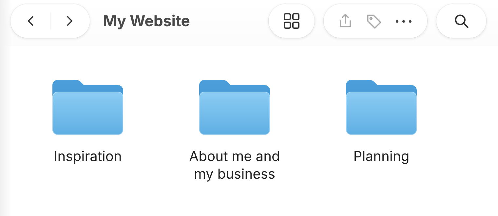
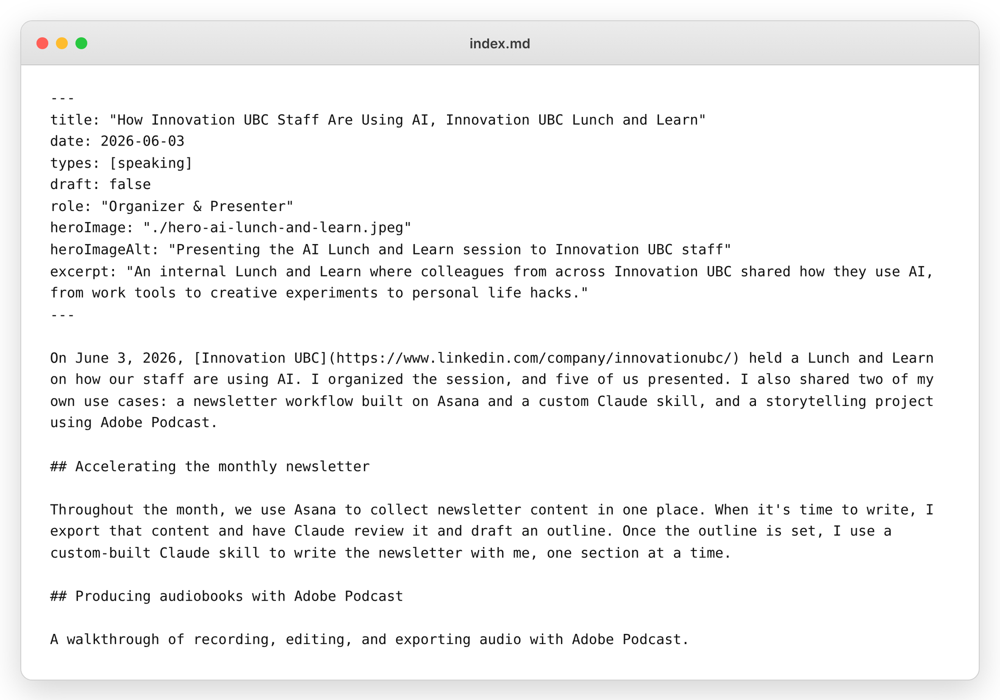
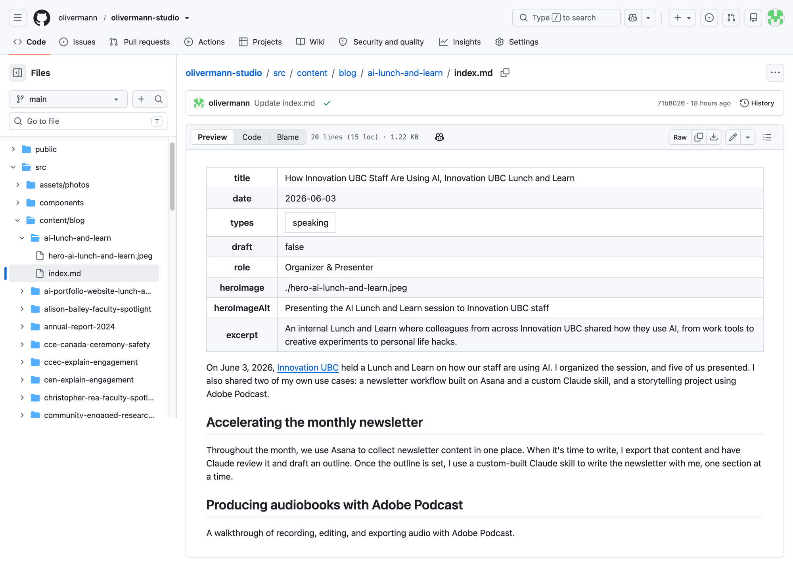
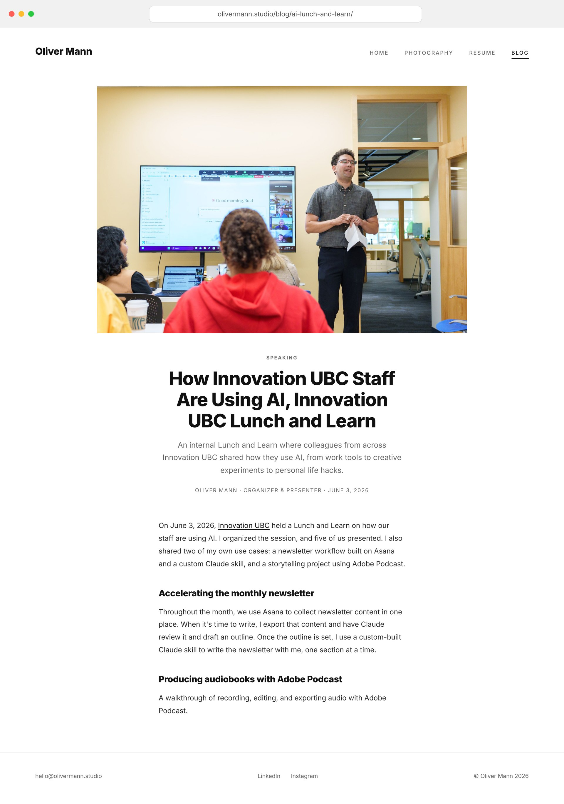
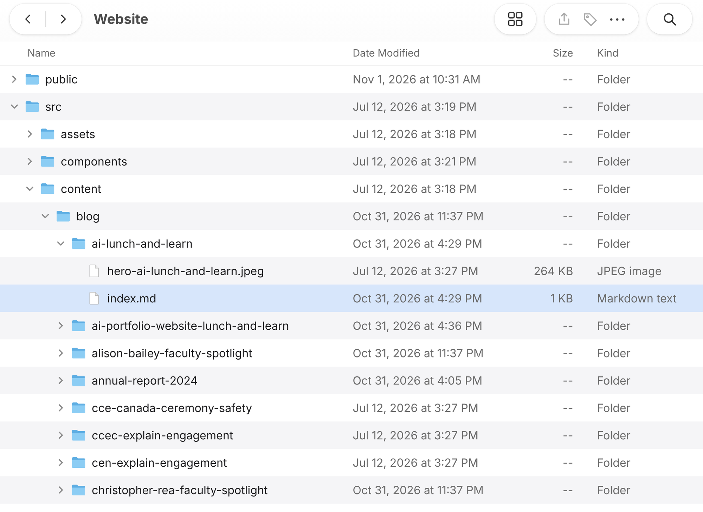
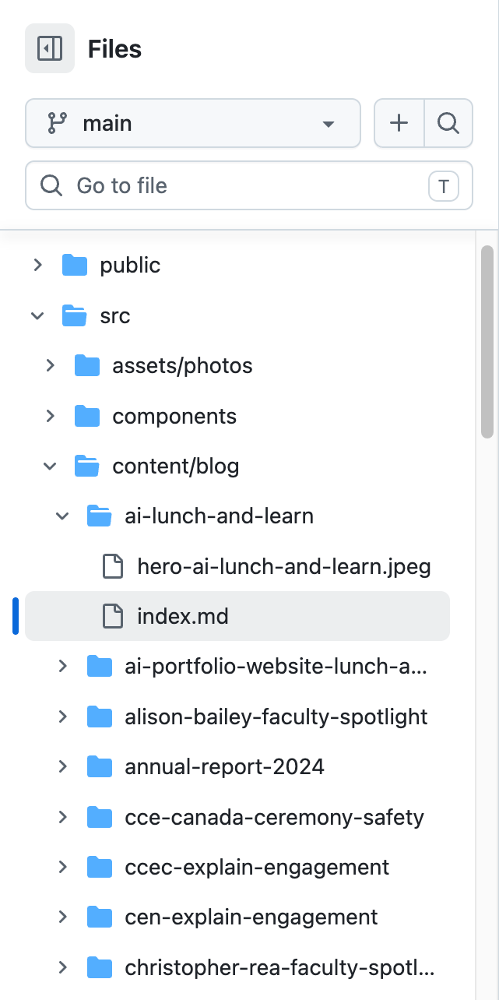

<div class="long-post">

On October 9, 2026, I led a virtual Lunch and Learn for [Innovation UBC](https://www.linkedin.com/company/innovationubc/) called Building a Simple Website with AI. It became Innovation UBC's most popular Lunch and Learn of 2026, with the most registrations and the highest attendance. You can read about the event on its [event page](/blog/ai-portfolio-website-lunch-and-learn/).

This post is the full written version of that workshop. It shows how I built the website you are on right now, olivermann.studio, with Claude over a single weekend. You will find my four-stage framework, every prompt I used, and a copy of my project brief.

## Who this is for

This is for casual AI users. If you use Claude, ChatGPT, Copilot or something similar, you have what you need. No coding experience is required. By the end, you should have everything you need to build and launch your own website.

**At a glance**

- **Time:** about 10 hours for me, spread over a weekend. I started on a Friday and went live on Sunday. With these steps and prompts, I hope you can do it in closer to 5.
- **Cost:** $0 per month beyond the domain name, which is about $15 per year.
- **Tools:** Claude, Astro, GitHub and Porkbun (all explained below).

<nav class="jump" aria-label="In this post"><span class="jump-label">Jump to</span><a href="#about-me-and-why-i-built-this-site">My story</a><a href="#stage-1-get-set-up-and-build-your-brief">Stage 1: Brief</a><a href="#stage-2-mock-it-up">Stage 2: Mock it up</a><a href="#stage-3-build-and-deploy">Stage 3: Build and deploy</a><a href="#stage-4-keep-adding-content-after-youre-live">Stage 4: Add content</a><a href="#recap">Recap</a></nav>

## About me and why I built this site

I have been working in marketing and communications for 15 years, and I have loved building digital things for even longer. I built my first website as a teenager, for my rock band. I have been the webmaster for several UBC websites since 2012, and I spent a few years doing freelance web building on the side. These days I am an early adopter of AI. I have some expertise, but I am always learning.

My goal was simple: a website to showcase both my photography and my communications work. The website I am talking about in this post is the one you are on right now: olivermann.studio.

The problem was cost. My old WordPress site, between the theme, hosting and the domain, ran close to $200 a year. I looked at free alternatives, but they limited how much control I had over design and functionality.

After many years of sitting on the fence about different solutions, I built this site with Claude over a single weekend. It costs nothing beyond buying the domain, and it is custom built to my exact design and functionality requirements. It is live, though still a work in progress.

I also think this is an efficient way for ventures to get a digital presence up quickly and cheaply.

## The four-stage framework

1.  **Stage 1:** Get set up with Claude and build your brief
2.  **Stage 2:** Mock it up
3.  **Stage 3:** Build and deploy
4.  **Stage 4:** Add content after you're live

## Stage 1: Get set up and build your brief

### Set up Claude

I used Claude Pro, but I imagine this framework would work with your AI tool of choice. Here is how I set it up:

- **I created a Claude project.** It keeps all the planning for the site in one place, so Claude kept building on the same context through the whole development, and I could jump between chats without losing that history.
- **I connected a context folder to the project.** More on that below.
- **I switched between two models depending on the task.** I used Opus for building, and Sonnet for planning and reviewing.

### Build your context folder

A context folder is a regular folder on your computer that you connect to your Claude project. Claude can read everything in it, so you don't have to re-explain yourself in every chat.

1.  Create one folder named after your project (for example, "My Website").
2.  Add these subfolders:
    - **Inspiration:** screenshots of sites, layouts or features you like
    - **About me and my business:** your resume, bio, pitch deck, logo and brand colours
    - **Planning:** leave this empty for now. Your brief will land here.
3.  Connect the folder to your Claude project. Claude will create new folders as the project grows.



A few things to keep in mind:

- **You don't need design vocabulary.** Screenshotting something you like and saying "something like this" is enough.
- **Don't overthink it.** Five to ten strong inspiration examples are more useful than fifty.
- **Give it real content.** Your bio, logo, photos, pitch deck, and any documents you already have. It will make building the final product quicker.
- **Name your files clearly.** Descriptive names are more useful to Claude than "Screenshot 123.jpg". For example, "homepage-big-photo-grid-and-minimal-menu.jpg" tells Claude what the image shows and why you saved it.
- **Treat it as a living folder.** Keep adding to it as the project grows.

### Create the brief

A brief puts every decision in writing before Claude goes off to build. It becomes the one document a fresh Claude chat can build from without you re-explaining everything.

Mine covers:

1.  Goals and cost target
2.  Tech stack and hosting choices
3.  The publishing workflow
4.  Site map, global design specs, and requirements for each individual page
5.  What's explicitly out of scope
6.  Recommended build process
7.  A definition of done: the launch checklist

You don't need to be an expert in any of these things. Instead, I asked Claude to interview me with a series of questions that helped me define the website I wanted to build. While I answered, Claude built the brief out from my answers.

Instead of keeping everything in the chat, I asked Claude to write the brief as a Word document that I could mark up and re-upload. We went back and forth like that until I was happy. Once it was final, I asked Claude to convert it into a Markdown file and save it in the context folder as a permanent reference.

**Steal this prompt: build the brief**

```text
Let's build the project brief. Interview me in batches of questions, not all at once, and cover:

- Project summary: what this site needs to do, and what it should cost to run
- Tech stack and hosting: I want to use Astro to build the site, GitHub to store the code and host it for free with GitHub Pages, and Porkbun for my domain. Explain the reasoning for each, and flag any limitations I should know about.
- The publishing workflow I'll actually use after launch, assuming I'm not a developer: I'll add new content by having you draft Markdown files that I upload to GitHub through its website, with no command line. The site should rebuild and republish automatically after each upload.
- Site map, global design specs, and requirements for each page
- Assets I already have available, and what's still needed from me
- What's explicitly out of scope for a first version
- A recommended build process, broken into phases
- A definition of done: a launch checklist

Once you have my answers, write the brief as a Word document so I can mark it up directly. We'll go back and forth on that Word doc until I'm happy with it. Once I confirm it's final, convert it into a Markdown file and save it in the context folder.
```

### See my project brief

Several people at the workshop asked what my brief looked like, so here it is. It is the real document I built the site from, with my revision notes and personal content removed. You can share it with your AI tool as an example of the type of brief you want to build.

<a class="pdf-button" href="/downloads/olivermann-studio-project-brief.pdf" target="_blank" rel="noopener">Download my project brief (PDF)</a>
<span class="pdf-meta">PDF, 8 pages. Opens in a new tab.</span>

## Stage 2: Mock it up

Once the brief was done, I asked Claude to mock up my main pages as HTML files. There was no need yet for a repository, hosting or deployment. Just static HTML and CSS, built to look at.

- I used Opus to create the mockups, since that is heavier creative and design work, then switched to Sonnet for the rounds of revision.
- The great thing about HTML files is that you can navigate and test your site in a browser without the site being live. It is a really simple way to see and test your website before actually building and deploying it.
- This is also a great moment to start feeding Claude your real content, real copy and real images.
- Ideally, you want your launch pages as close to finished as possible before you move into building and deploying.

For my site, I had mockups for the home page, the photography page, the blog page and a blog post. I opened each file in a browser and clicked between them like a real site.

Want to see what these look like? Here are three of my early mockups. They are plain HTML files, so you can click around them like a real site:

- [Home page mockup](/mockup-examples/)
- [Photography page mockup](/mockup-examples/photography.html)
- [Blog page mockup](/mockup-examples/blog.html)

These are early versions, so they differ slightly from the finished site. You can also share them with your AI tool as examples of the kind of mockup you want.

**Steal this prompt: mock it up**

```text
The finalized brief is in the context folder. Before building anything real, create static HTML and CSS mockups only. No repository, hosting, or deployment yet.

Build one page at a time, starting with the home page. Show me each one before moving to the next. Once I approve a page, move on to the next:

[list your remaining pages, e.g. photography, blog, blog post].

Use real content and images where I've given them to you, and placeholder text or stock images only where I haven't yet. I want to open each file in a browser and click between the approved pages like a real site.
```

## Stage 3: Build and deploy

When my mockups were ready and I wanted to go live, I used a stack of three tools:

- **[Astro](https://astro.build/)** builds your site's files
- **[GitHub](https://github.com/)** stores your code and publishes it
- **[Porkbun](https://porkbun.com/)** owns your domain and points it at your site

You don't need expertise in any of these. Claude handles the creation of all the files and walks you through everything else.

### Astro: builds your site's files

Astro takes your content and page templates and assembles them into the HTML, CSS and JavaScript files a browser reads. It is built for fast, lightweight, content-heavy sites like a portfolio or blog. There is no database, just static files.

**The catch:** Astro has no visual editor. Content lives in Markdown files (more on those below) and templates live in code, so future edits will need Claude's help.

### GitHub: stores your code and publishes it

GitHub stores your code and publishes your site for free.

**The catches:**

- It can be intimidating, until you realize it is a simple folder system. Imagine a Google Drive folder. I show you what I mean at the end of this stage.
- It is only for static sites. There is no user engagement like forms, logins or comments.
- There is no built-in analytics.
- If GitHub has an outage, so does your site.

> **Important:** On the free plan, anyone can view and clone your files. Do not put confidential IP, unpublished research or private information in your repository.

### Porkbun: owns your domain

Porkbun is the domain registrar. You buy and manage your domain name there (mine is olivermann.studio), and it tells a browser where to send visitors when they type your domain. It is an inexpensive, straightforward DNS management tool, at about $15 per year.

### Run the three prompts, in order

Use these three prompts in order, in the same Claude project, and let each one finish before you start the next. Each prompt tells Claude you are a beginner, so it explains each step instead of assuming you know it. Prompt 1 builds your site, and Prompts 2 and 3 take it live.

### Prompt 1: build the site in Astro

Claude builds the real site from your approved mockups and your brief. When it is done, you will have a folder of site files on your computer. The tour at the end of the prompt explains where everything lives, which will help you when you upload your files in Prompt 3.

```text
The HTML and CSS mockups in the context folder are final and approved. Build the real website now, using Astro, following the tech stack and structure in the brief.

Match every approved mockup page exactly: same layout, same copy, same images. Set up proper content collections for anything that will repeat, like blog posts, so I can add new entries later just by adding a file. Keep the folder structure simple enough that I can find and edit things myself without coding knowledge.

Once it's built, give me a short tour of the project structure so I understand where everything lives before we move on to deploying it.
```

### Prompt 2: buy a domain on Porkbun

You need your domain before you can go live, so this comes second. Claude walks you through choosing and buying one.

```text
I need to buy a domain name for this website on Porkbun. I've never bought a domain before, so walk me through it step by step:

- What to search for, and how to tell if a domain is actually available
- What to watch out for before I buy, like auto-renewal or add-ons I don't need
- Roughly what it should cost for the domain I want
- What to do right after I buy it, before we connect it to GitHub
```

### Prompt 3: create a GitHub account, upload your files, connect your domain, and go live

This is the longest step. Claude goes one step at a time and waits for you to confirm before moving on, so you will go back and forth with it. Have your Porkbun login ready, and expect Claude to point you to a few screens on the GitHub and Porkbun websites.

```text
I want to take this live now. I've never used GitHub before, so walk me through every step in plain language, one at a time, and wait for me to confirm each one is done before moving to the next:

- Creating a GitHub account and a new public repository for this project
- Uploading my site files to that repository using GitHub's website, no command line
- Setting up GitHub Actions so the site rebuilds and republishes automatically every time I upload a change
- Turning on GitHub Pages and pointing it at my custom domain
- Telling me exactly which DNS records to add in Porkbun, and where to find that screen

After each step, tell me how to check that it actually worked before we move on.
```

### What you will see along the way

Two things may look unfamiliar as you work through those prompts: Markdown files, which hold your content, and GitHub, which holds your files. Here is what each one looks like.

### What a Markdown file looks like

Each page of my site is a Markdown (.md) file, and Claude writes them for you. A Markdown file is plain text with a few simple symbols. The block at the top, between the two lines of dashes, holds details like the title, date and image. Everything below it is the post itself. A \## in front of a line makes it a heading.

Here is one of my posts as it looks when I open the file on my computer:



Here is the same file on GitHub. GitHub shows the details as a tidy table, with the text underneath:



And here is the same file on the live site, after the site rebuilt itself:



### GitHub is just a folder

GitHub looks technical, but your website on GitHub is the same folder you have on your computer. This is my website folder on my computer:



And this is the same folder on GitHub:



It is the same structure. (GitHub sometimes joins a folder and the folder inside it onto one line, like content/blog, but it is the same thing.) To publish something new, I drag a file or folder from my computer into the matching spot on GitHub. That upload is what rebuilds the site and puts the change live. It is what you will do in Prompt 3 when Claude asks you to upload your site files, and it is how you add new content after you launch. You can even edit text directly on GitHub when you need a quick fix.

## Stage 4: Keep adding content after you're live

After you launch on GitHub, your site is live and viewable by the world. If all of your content is done, you can call it a day here.

In my case, I want to add new content regularly. The trick is to build a reusable prompt for each type of content you'll add. Here are two of mine.

### Example 1: draft a blog post

My first reusable prompt works in three steps:

1.  Claude interviews me about the situation, my approach, the results and what I learned.
2.  Claude confirms an outline before writing.
3.  Claude drafts the post as a Markdown file that is ready to upload to GitHub.

Here is the pattern as a prompt you can adapt:

```text
I want to write a new blog post for my website. Work in three stages and don't skip ahead to drafting.

Stage 1: Interview me in small batches of 3 to 5 questions: the topic, the situation, what I did step by step, the results (ask for real numbers and where they come from), and what I learned.

Stage 2: Show me a one-screen outline and wait for my sign-off.

Stage 3: Draft the post as a single Markdown file, ready to upload to GitHub, using the front matter format in my brief.

Never invent facts, names or numbers. If something is missing, ask me or mark it [TODO].
```

### Example 2: add examples of content you've created

My second reusable prompt is for adding writing, video or podcast examples to my site:

1.  Claude asks first: does this link out to externally published work, or does it need a hosted post on my site?
2.  Claude interviews me for whichever path applies. It works for one story or a batch of several at once.
3.  Claude drafts each story as a Markdown file that is ready to upload to GitHub.

If a piece links out, the prompt just pulls the info it needs for the card. Very simple. You can see how these look on my [blog](/blog/#writing).

```text
I want to add a piece of content I've created to my website (a story, video or podcast). First ask me: does this link out to the externally published work, or does it need a hosted post on my site?

Then interview me for whichever path applies. This should work for one piece or a batch of several at once.

Draft each one as a Markdown file that is ready to upload to GitHub.
```

## Recap

1.  **Create a brief:** write the plan before you touch any code.
2.  **Mock it up:** see and test the design before it's real.
3.  **Build and deploy:** Astro, GitHub and Porkbun.
4.  **Add content after you're live:** keep using Claude and create reusable prompts to draft new content quickly.

I built my little portfolio website over a weekend, starting on a Friday and going live on Sunday, in about 10 hours total. With these steps and prompts, I hope you can launch even faster.

## Questions, feedback, or a workshop for your group

If you try this and get stuck, or have feedback on the framework, I would love to hear from you. And if you would like me to present this workshop to your group, email me at <hello@olivermann.studio>.

</div>
