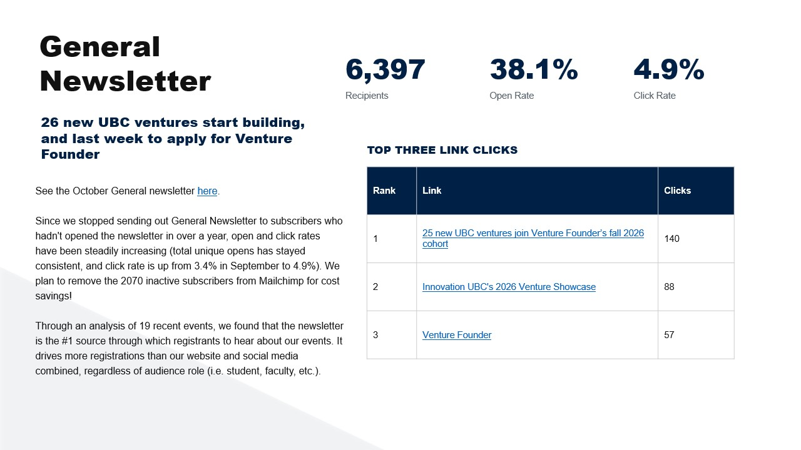

<nav aria-label="On this page" class="side-nav">
Jump to
<a href="#strategy">Strategy</a>
<a href="#process">Process</a>
<a href="#results">Results</a>
</nav>

Innovation UBC's newsletter is one of its three most significant owned communications channels, alongside its website and social media.

Before I joined Innovation UBC, its newsletter had no regular schedule. Emails went out around event deadlines, with no monthly cadence. The design varied from send to send, and each email was short and featured only Innovation UBC's own content, with little room for partners.

In January 2026, I launched Innovation UBC's monthly newsletter as one of my first deliverables. Each edition brings together upcoming events and programs, original stories, news about UBC ventures and researchers, and opportunities from across the innovation ecosystem, in a five-minute read.

I also built several new processes to improve collaboration and production: a content intake system, a shared drafting workflow supported by a custom Claude skill, an analytics tracking system, and an Asana project to manage each edition from start to finish.

The newsletter now goes out every month with a cohesive design. Compared to 2025, unique opens are up 16% and unique clicks are up 19%. It is the number one driver of event registrations, ahead of the website and social media combined. I also cut its cost by 51%.

+16%unique opens per send, compared to 2025

+19%unique clicks per send, compared to 2025

37%of event registrants come from the newsletter

51%lower Mailchimp costs

<a class="btn" href="/downloads/innovation-ubc-newsletter-2025-vs-2026.pdf" rel="noopener" target="_blank">See the 2025 and 2026 newsletters side by side →</a>PDF

Collaborators
<ul><li>

<strong>Adella Teja</strong>Digital Marketing Assistant, Innovation UBC

Co-writing, submissions management, analytics, and mailing list management

</li>
<li>

<strong>Jaime Clanachan</strong>Communications Specialist (Creative Content), Innovation UBC

Design and Mailchimp build

</li>
</ul>

<nav aria-label="Jump to section" class="jump">
Jump to
<a href="#strategy">Strategy</a>
<a href="#process">Process</a>
<a href="#results">Results</a>
</nav>

## Strategy

### Audiences

I defined three audiences for the newsletter:

- UBC faculty, students and staff interested in Innovation UBC's programs, events and supports.
- Innovation UBC's close-knit community of people involved in its programs: entrepreneurs and venture founders, mentors, and Entrepreneurs in Residence.
- The external ecosystem: investors and funders, government and industry professionals, UBC alumni, and community members who follow Innovation UBC news, stories and events.

### Objectives

I set five objectives for the newsletter:

- Put the month's top priority in front of every reader
- Drive registrations and applications for Innovation UBC's events and programs
- Drive traffic to Innovation UBC's original stories, supports and resources
- Celebrate the impact of UBC ventures and researchers who have come through Innovation UBC's programs and services
- Contribute to the wider ecosystem and practise reciprocity by sharing community events and opportunities.

### Layout and design

I organized the newsletter into six sections that map to the objectives. The most valuable real estate is at the top, so I reserved sections 1 to 3 for owned content, meaning things Innovation UBC runs, hosts or publishes. Sections 4 to 6 are open to external and ecosystem content.

- Top story: the single most important thing to promote this month, usually a program actively recruiting or a flagship event with registration open.
- Upcoming events and programs
- Stories
- Recent venture and researcher news
- Community events and opportunities
- Resource spotlight

<figure class="fig wide">

<b>OWNED CONTENT</b>Things Innovation UBC runs, hosts or publishes

1 Top story

Objective 1: Put the month’s top priority in front of every reader

<svg aria-hidden="true" class="wf-arrow" viewbox="0 0 64 64"><path d="M4 30 C 16 12, 34 8, 56 20" pathlength="1"></path><path d="M46 12 L57 20 L45 25" pathlength="1"></path></svg>

1
Top Story

2 Upcoming events and programs

Objective 2: Drive registrations and applications for events and programs

<svg aria-hidden="true" class="wf-arrow" viewbox="0 0 64 64"><path d="M4 30 C 16 12, 34 8, 56 20" pathlength="1"></path><path d="M46 12 L57 20 L45 25" pathlength="1"></path></svg>

2
Upcoming Events and Programs

3 Stories

Objective 3: Drive traffic to original stories, supports and resources

<svg aria-hidden="true" class="wf-arrow" viewbox="0 0 64 64"><path d="M4 30 C 16 12, 34 8, 56 20" pathlength="1"></path><path d="M46 12 L57 20 L45 25" pathlength="1"></path></svg>

3
Stories

<b>ECOSYSTEM CONTENT</b>Open to partner and community content

4 Recent venture and researcher news

Objective 4: Celebrate the impact of UBC ventures and researchers

<svg aria-hidden="true" class="wf-arrow" viewbox="0 0 64 64"><path d="M6 54 C 18 44, 30 22, 56 8" pathlength="1"></path><path d="M45 6 L57 8 L52 19" pathlength="1"></path></svg>

4
Recent Venture and Researcher News

<i style="--w:88%"></i>

<i style="--w:80%"></i>

<i style="--w:90%"></i>

<i style="--w:74%"></i>

<i style="--w:82%"></i>

5 Community events and opportunities

Objective 5: Contribute to the wider ecosystem and practise reciprocity

<svg aria-hidden="true" class="wf-arrow" viewbox="0 0 64 64"><path d="M6 54 C 18 44, 30 22, 56 8" pathlength="1"></path><path d="M45 6 L57 8 L52 19" pathlength="1"></path></svg>

5
Community Events and Opportunities

<i style="--w:86%"></i>

<i style="--w:76%"></i>

<i style="--w:80%"></i>

<i style="--w:78%"></i>

<i style="--w:66%"></i>

6 Resource spotlight

Objective 3: Drive traffic to resources and supports

<svg aria-hidden="true" class="wf-arrow" viewbox="0 0 64 64"><path d="M6 54 C 18 44, 30 22, 56 8" pathlength="1"></path><path d="M45 6 L57 8 L52 19" pathlength="1"></path></svg>

6
Resource Spotlight

<figcaption>How the six sections map to the newsletter’s objectives.<button class="replay" data-replay="wireframe" type="button">↻ Replay</button></figcaption>
</figure>

For the first two editions, in January and February, I was on my own, so I built the design in Mailchimp from scratch. In March, Jaime Clanachan joined Innovation UBC as their designer. Jaime has taken the design much further and continues to improve it with every edition.

### Editorial guidelines

I wrote editorial guidelines so every edition reads the same. This includes things like short paragraphs and active voice, speaking to the reader, making the second sentence of a story an invitation, and specific calls to action.

### Schedule

The newsletter goes out on the first Tuesday of each month. Tuesday mornings had the best engagement for the newsletter I ran at my last job, so I brought that timing with me.

### See examples of recent newsletters

<a class="btn" href="/downloads/innovation-ubc-newsletter-october-2026.pdf" rel="noopener" target="_blank">View the October 2026 edition →</a>PDF

<a class="btn" href="/downloads/innovation-ubc-newsletter-november-2026.pdf" rel="noopener" target="_blank">View the November 2026 edition →</a>PDF

Want to see it land in your inbox? [Subscribe to the Innovation UBC newsletter](https://ubc.us7.list-manage.com/subscribe?u=6912f2b3ab92991c5324b89d1&id=fc7f643ce5).

## Process

As a project, the newsletter takes about a week and a half, from the call for submissions to the send.

<figure class="fig">

About a week and a half from the call for submissions to the send. Analytics are pulled a week later.

About a week and a half

A week later

<ol class="tl-steps">
<li style="--d:0s">Day 1Call for submissions</li>
<li style="--d:.27s">Day 5Outline created</li>
<li style="--d:.54s">Day 6Copy drafted</li>
<li style="--d:.81s">Day 7Manager review</li>
<li style="--d:1.08s">Day 8Mailchimp build and review</li>
<li class="send" style="--d:1.4s">Day 9Send (Tuesday)</li>
<li class="later" style="--d:2.05s">Day 15Analytics pulled</li>
</ol>

</figure>

### Collecting submissions

Content for each edition comes from three places:

- **Innovation UBC's content pipeline.** The marketing team schedules its next batch of original stories to publish before the newsletter goes out, so they're ready to feature.
- **Key stakeholders.** About a week and a half before send day, I email them directly and ask for submissions.
- **Ecosystem partners.** Partners submit events and opportunities to promote throughout the month.

View the call for submissions email 

Email template<button class="copy-btn" type="button">Copy</button>

<pre>Subject: Content for the next newsletter&#10;&#10;Hi [Name],&#10;&#10;I'm putting together the next edition of the [organization] newsletter. The expected publish date is [insert date]. Are there any events, programs or opportunities you'd like me to include?&#10;&#10;You can see the last edition here: [insert link]&#10;&#10;If you have content to feature in the "upcoming events and programs" or "stories" sections, I'll need:&#10;&#10;- URL to details&#10;- Image&#10;&#10;If your content is for the "community events and opportunities" section, I'll just need the URL to details.&#10;&#10;Please let me know by [date] if you'd like anything included.&#10;&#10;Thanks,</pre>

### Managing submissions in Asana

For each submission, I track the following information, which gives me a head start on drafting.

<table class="fields">
<caption>Fields for each submission</caption>
<tbody>
<tr><th scope="row">Title</th><td>Name of the event, program, story or opportunity</td></tr>
<tr><th scope="row">URL</th><td>Link to the details page</td></tr>
<tr><th scope="row">Key date</th><td>Application deadline or event date</td></tr>
<tr><th scope="row">Source</th><td>Who submitted it</td></tr>
<tr><th scope="row">Proposed section</th><td>Which of the six sections it belongs in</td></tr>
<tr><th scope="row">Notes</th><td>Anything to remember when drafting</td></tr>
</tbody>
</table>

I built a Content Intake project in Asana for this process, and we use it to assign content to all of our channels. Anyone can forward a submission, such as a partner's event, by email straight into the project. The submission is then reviewed by Adella Teja, Innovation UBC's Digital Marketing Assistant. Adella pulls the key details and assigns it to the channels that will promote it: the website, social media, the newsletter, Slack or digital signage. Each channel gets an automatic task with all the relevant details.

<figure class="fig">

Submission arrives by email

Content Intake projectForwarded into Asana

Submission is reviewedKey details pulled out

Assigned to each channelEach gets an automatic task

Website

Social media

Newsletter

Slack

Digital signage

<svg aria-hidden="true" class="fan"></svg>

<figcaption>How a submission moves through the Content Intake project in Asana.<button class="replay" data-replay="intake" type="button">↻ Replay</button></figcaption>
</figure>

### Drafting collaboratively, with a Claude skill

Drafting is now collaborative, built around a shared Word document and a custom Claude skill that speeds up the work and keeps every edition consistent.

#### Outline and writing

I start by creating an outline that maps each submission to its section and sets the order. The copy for the whole newsletter is then drafted in a Word document, which makes it easy to share for review and to add late content as it comes in.

I co-write the newsletter with Adella. I write the top story, upcoming events and programs, stories, and resource spotlight (sections 1, 2, 3 and 6). Adella drafts recent venture and researcher news and community events and opportunities (sections 4 and 5).

#### Speeding up the process with a custom Claude skill

I built a set of written instructions that Claude loads whenever I start a newsletter. It holds all the context for the newsletter, from the six-section structure to the editorial guidelines and my preferred writing style, so I never have to explain it from scratch.

For each submission, I give Claude the URL and the section it belongs in. Claude reads the page, pulls the details and drafts the copy. Everything Claude creates is reviewed and edited by me. Once I approve, I copy it to the Word doc and move to the next item.

I share the skill with Adella so our content stays consistent. I also update it after every edition so it keeps improving.

<a class="btn" href="/downloads/innovation-ubc-newsletter-skill.md" rel="noopener" target="_blank">
<svg aria-hidden="true" class="spark" fill="currentColor" viewbox="0 0 24 24"><path d="M12 0c.6 6.6 5.4 11.4 12 12-6.6.6-11.4 5.4-12 12-.6-6.6-5.4-11.4-12-12C6.6 11.4 11.4 6.6 12 0z"></path></svg>
View the Claude skill (.md) →
</a>Markdown (.md) file

#### Review

Once the draft is complete, it goes to my manager for review. Because it's in a Word document, reviewers can leave comments and suggest edits, which I can quickly approve or address.

Once the draft is approved, I hand the Word document to Jaime, who builds it in Mailchimp. When it's built, I do a final review and schedule the newsletter.

### Tracking results

After each send, Adella logs the results in our master analytics spreadsheet, which I created to track data across all of our channels. It takes a minute and it builds a record we can learn from.

View the analytics spreadsheet columns 

<table class="fields">
<tbody>
<tr><th scope="row">Send date</th><td>Date the newsletter went out</td></tr>
<tr><th scope="row">List</th><td>Which list it was sent to</td></tr>
<tr><th scope="row">Subject line</th><td>The subject line that was sent</td></tr>
<tr><th scope="row">Newsletter link</th><td>Link to view the newsletter</td></tr>
<tr><th scope="row">Recipients</th><td>Number of contacts it was sent to</td></tr>
<tr><th scope="row">Open rate</th><td>Percentage who opened</td></tr>
<tr><th scope="row">Click rate</th><td>Percentage who clicked</td></tr>
<tr><th scope="row">Most clicked item</th><td>The link with the most clicks</td></tr>
<tr><th scope="row">Second most clicked</th><td>The link with the second most clicks</td></tr>
<tr><th scope="row">Third most clicked</th><td>The link with the third most clicks</td></tr>
</tbody>
</table>

The results then feed into the monthly marketing report Adella builds. It goes to the marketing team, key stakeholders and Innovation UBC's executive team.

The newsletter slide from the October 2026 marketing report.

### Running the project in Asana

I built an Asana project that manages the whole process, from the first call for content to the analytics after the send. It has a section for each stage, and every task has an owner and a due date, so everyone can see who is doing what and what comes next.

<figure class="fig">

<svg fill="none" stroke="#fff" stroke-linecap="round" stroke-width="1.8" viewbox="0 0 16 16"><path d="M5 4h8M5 8h8M5 12h8"></path><circle cx="2.2" cy="4" fill="#fff" r=".6"></circle><circle cx="2.2" cy="8" fill="#fff" r=".6"></circle><circle cx="2.2" cy="12" fill="#fff" r=".6"></circle></svg>
Monthly newsletter▾

OAJM

Share

OverviewListBoardTimelineCalendarWorkflowFiles

+ Add taskFilterSortGroupOptions

NameAssigneeDue date

<button aria-expanded="true" class="as-sec">Planning</button>

<button aria-label="Mark complete" class="as-check"><svg viewbox="0 0 10 10"><path d="M2 5.2l2 2 4-4.4" fill="none" stroke="#58a182" stroke-linecap="round" stroke-linejoin="round" stroke-width="1.6"></path></svg></button>Confirm newsletter send date

OOliver
Day 1

<button aria-label="Mark complete" class="as-check"><svg viewbox="0 0 10 10"><path d="M2 5.2l2 2 4-4.4" fill="none" stroke="#58a182" stroke-linecap="round" stroke-linejoin="round" stroke-width="1.6"></path></svg></button>Send content call to stakeholders

OOliver
Day 1

<button aria-expanded="true" class="as-sec">Drafting</button>

<button aria-label="Mark complete" class="as-check"><svg viewbox="0 0 10 10"><path d="M2 5.2l2 2 4-4.4" fill="none" stroke="#58a182" stroke-linecap="round" stroke-linejoin="round" stroke-width="1.6"></path></svg></button>Create newsletter outline

OOliver
Day 5

<button aria-label="Mark complete" class="as-check"><svg viewbox="0 0 10 10"><path d="M2 5.2l2 2 4-4.4" fill="none" stroke="#58a182" stroke-linecap="round" stroke-linejoin="round" stroke-width="1.6"></path></svg></button>Draft newsletter copy

OOliver
Day 6

<button aria-label="Mark complete" class="as-check"><svg viewbox="0 0 10 10"><path d="M2 5.2l2 2 4-4.4" fill="none" stroke="#58a182" stroke-linecap="round" stroke-linejoin="round" stroke-width="1.6"></path></svg></button>Top story

<button aria-label="Mark complete" class="as-check"><svg viewbox="0 0 10 10"><path d="M2 5.2l2 2 4-4.4" fill="none" stroke="#58a182" stroke-linecap="round" stroke-linejoin="round" stroke-width="1.6"></path></svg></button>Upcoming events and programs

<button aria-label="Mark complete" class="as-check"><svg viewbox="0 0 10 10"><path d="M2 5.2l2 2 4-4.4" fill="none" stroke="#58a182" stroke-linecap="round" stroke-linejoin="round" stroke-width="1.6"></path></svg></button>Stories

<button aria-label="Mark complete" class="as-check"><svg viewbox="0 0 10 10"><path d="M2 5.2l2 2 4-4.4" fill="none" stroke="#58a182" stroke-linecap="round" stroke-linejoin="round" stroke-width="1.6"></path></svg></button>Resource spotlight

<button aria-label="Mark complete" class="as-check"><svg viewbox="0 0 10 10"><path d="M2 5.2l2 2 4-4.4" fill="none" stroke="#58a182" stroke-linecap="round" stroke-linejoin="round" stroke-width="1.6"></path></svg></button>Draft community and venture content

AAdella
Day 6

<button aria-label="Mark complete" class="as-check"><svg viewbox="0 0 10 10"><path d="M2 5.2l2 2 4-4.4" fill="none" stroke="#58a182" stroke-linecap="round" stroke-linejoin="round" stroke-width="1.6"></path></svg></button>Recent venture and researcher news

<button aria-label="Mark complete" class="as-check"><svg viewbox="0 0 10 10"><path d="M2 5.2l2 2 4-4.4" fill="none" stroke="#58a182" stroke-linecap="round" stroke-linejoin="round" stroke-width="1.6"></path></svg></button>Community events and opportunities

<button aria-label="Mark complete" class="as-check"><svg viewbox="0 0 10 10"><path d="M2 5.2l2 2 4-4.4" fill="none" stroke="#58a182" stroke-linecap="round" stroke-linejoin="round" stroke-width="1.6"></path></svg></button>Review newsletter copy

MManager
Day 7

<button aria-expanded="true" class="as-sec">Mailchimp: build newsletter</button>

<button aria-label="Mark complete" class="as-check"><svg viewbox="0 0 10 10"><path d="M2 5.2l2 2 4-4.4" fill="none" stroke="#58a182" stroke-linecap="round" stroke-linejoin="round" stroke-width="1.6"></path></svg></button>Build newsletter in Mailchimp

JJaime
Day 8

<button aria-label="Mark complete" class="as-check"><svg viewbox="0 0 10 10"><path d="M2 5.2l2 2 4-4.4" fill="none" stroke="#58a182" stroke-linecap="round" stroke-linejoin="round" stroke-width="1.6"></path></svg></button>Review Mailchimp build

OOliver
Day 8

<button aria-label="Mark complete" class="as-check"><svg viewbox="0 0 10 10"><path d="M2 5.2l2 2 4-4.4" fill="none" stroke="#58a182" stroke-linecap="round" stroke-linejoin="round" stroke-width="1.6"></path></svg></button>Publish or schedule newsletter

OOliver
Day 9

<button aria-expanded="true" class="as-sec">Analytics and measurement</button>

<button aria-label="Mark complete" class="as-check"><svg viewbox="0 0 10 10"><path d="M2 5.2l2 2 4-4.4" fill="none" stroke="#58a182" stroke-linecap="round" stroke-linejoin="round" stroke-width="1.6"></path></svg></button>Pull newsletter analytics

AAdella
Day 15

<figcaption>A recreation of the newsletter project in Asana. Try checking off a task or collapsing a section.</figcaption>
</figure>

Asana makes it easy to collaborate across the team and give feedback. Because the project structure is the same every month, the project is easy to replicate, and I can keep building on it from one newsletter to the next.

## Results

### Engagement rose on every measure and continues to grow

The average open rate rose from 28.7% to 33.9%, and six of the 11 editions in 2026 beat the best open rate of 2025. November's beat it by more than six points.

<table class="data">
<caption>Newsletter engagement2025 compared to 2026</caption>
<thead>
<tr><th scope="col">Measure</th><th scope="col">2025</th><th scope="col">2026 (Jan to Nov)</th><th scope="col">Change</th></tr>
</thead>
<tbody>
<tr><th scope="row">Average open rate</th><td>28.7%</td><td>33.9%</td><td class="up">+5.2 points</td></tr>
<tr><th scope="row">Average click rate</th><td>3.2%</td><td>3.9%</td><td class="up">+0.7 points</td></tr>
<tr><th scope="row">Average unique opens per send</th><td>2,177</td><td>2,515</td><td class="up">+16%</td></tr>
<tr><th scope="row">Average unique clicks per send</th><td>246</td><td>292</td><td class="up">+19%</td></tr>
<tr><th scope="row">Best open rate</th><td>33.5% (Oct)</td><td>39.6% (Nov)</td><td class="up">+6.1 points</td></tr>
</tbody>
</table>

Open rates trended up through the year, from 29.9% in January to 39.6% in November, and every edition since August has been above 36%. Click rates followed, from 3.0% in January to 5.7% in November.

<figure class="fig">

Newsletter, 2026Open rate by month

Newsletter, 2026Click rate by month

<figcaption class="replay-only"><button class="replay" data-replay="trends" type="button">↻ Replay</button></figcaption>
</figure>

### Delivering on its objectives: the number one driver of event registrations

When I looked at Innovation UBC's latest 2026 event data, the newsletter was the number one source of registrants. Second place wasn't even close. 37% of event registrants come from Innovation UBC's newsletter, 2x as much as the website, and 2.7x as much as social media. Equally interesting, this held true across all audiences: faculty, students, investors, industry. The newsletter was the top driver of event registrations for everyone.

<figure class="fig">

Event registrations, 2026Where event registrants heard about the event

Email newsletter

36.7%

Innovation UBC website

18.4%

Social media

13.8%

0%10%20%30%40%50%

<figcaption class="replay-only"><button class="replay" data-replay="chart" type="button">↻ Replay</button></figcaption>
</figure>

The newsletter also delivers on the other objectives I set. It puts the month's top priority in front of every reader. The top story consistently draws over 100 clicks. In October, it got 140 clicks. In November, it got 254.

It also contributes to the wider ecosystem. Each edition carries 10+ community events and 10+ opportunities from partners, which makes it one of Innovation UBC's most valuable channels for reciprocity. Partners are more willing to share Innovation UBC's content when it shares theirs.

### Cutting costs by over 50%

Mailchimp charges by the number of contacts across all of its lists, so the size of a mailing list affects cost as well as results. When I joined Innovation UBC, I inherited more than a dozen mailing lists, most of them inactive. Mailchimp was still charging for all of them. I cleaned them up in two phases with Adella.

**Phase one:** We merged as many lists as we could into one and removed duplicate emails. For everyone else, we sent a one-time re-invite, and anyone who didn't opt back in was retired. The list ended this phase at just over 8,000 contacts, and that brought Innovation UBC's Mailchimp costs down by 51%.

**Phase two:** Open and click rates were still lower than I wanted, so I took a closer look. About 2,000 contacts hadn't opened an email in 12 months. I segmented them out, and the list dropped to 6,342. As expected, unique opens barely moved, while open and click rates climbed. The next step is to remove the non-openers from Mailchimp entirely, which should lower costs again.

<table class="data">
<caption>Mailing list cleanupResults by phase</caption>
<thead>
<tr><td></td><th scope="col">2025</th><th scope="col">Phase one cleanup</th><th scope="col">Phase two cleanup</th></tr>
</thead>
<tbody>
<tr><th scope="row">Average list size</th><td>7,580</td><td>8,106</td><td>6,440</td></tr>
<tr><th scope="row">Open rate</th><td>28.7%</td><td>31.4%</td><td>38.3%</td></tr>
<tr><th scope="row">Click rate</th><td>3.2%</td><td>3.6%</td><td>4.5%</td></tr>
<tr><th scope="row">Unique opens per send</th><td>about 2,180</td><td>about 2,550</td><td>about 2,460</td></tr>
</tbody>
</table>

## Conclusion

Innovation UBC now has a monthly newsletter. Over the last 11 months, there have been 11 newsletters. I also write a tailored Venture newsletter for current and alumni ventures in Innovation UBC's programs. It has grown from 190 to 429 recipients, with a 45% average open rate and a 5.8% average click rate.

I've been writing newsletters for 15 years, and this is a system I know works. At UBC Community Engagement, my previous role, I also launched their monthly newsletter and grew its mailing list from 0 to more than 2,000 subscribers. That newsletter had a 49% average open rate and a 9% average click rate. I bring the system with me from team to team and keep improving it.

If your unit is starting a newsletter or giving one a reset, I'd love to talk.

<a class="btn" href="mailto:hello@olivermann.studio?subject=Starting%20a%20newsletter">Get in touch →</a>hello@olivermann.studio

